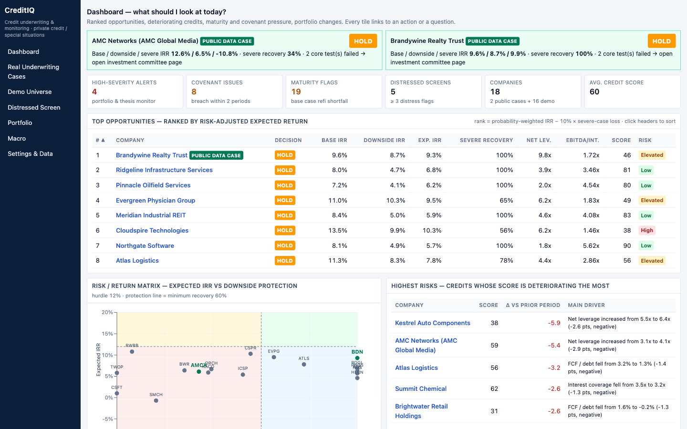
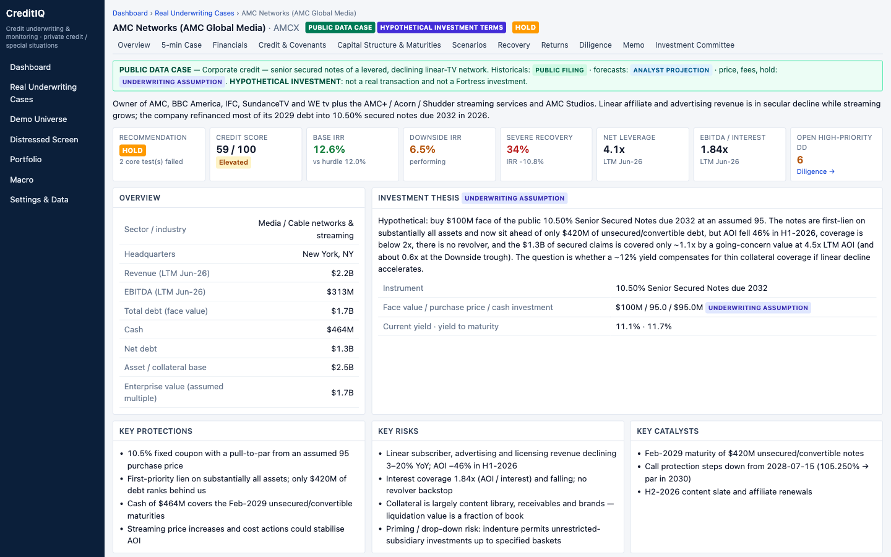
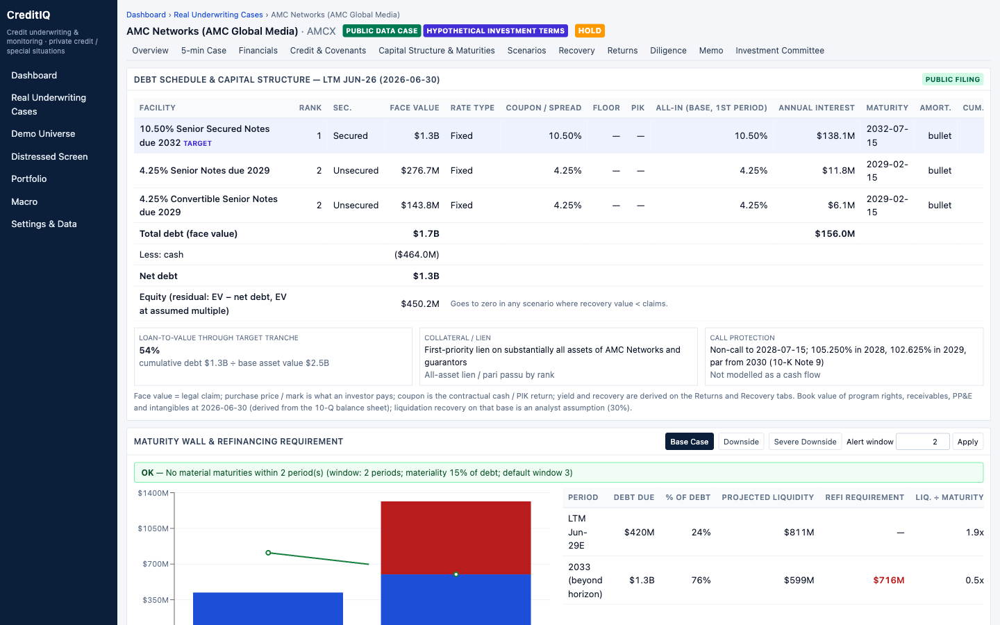
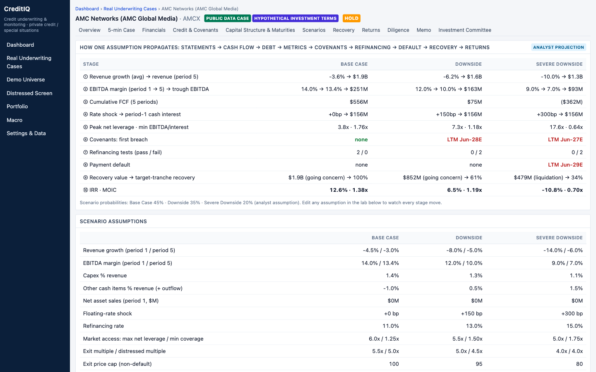
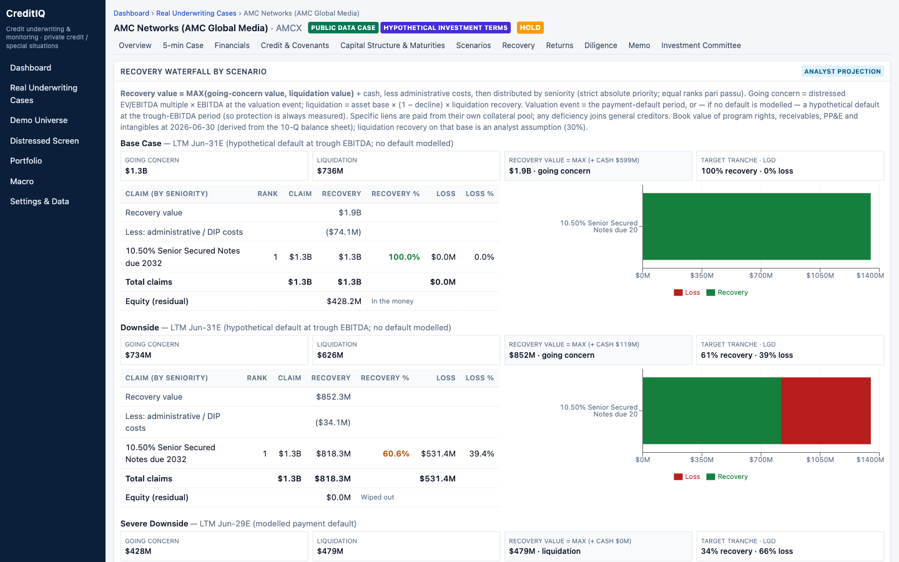
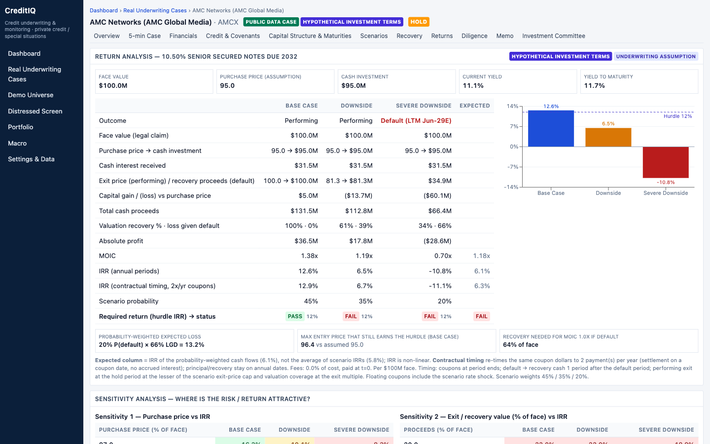
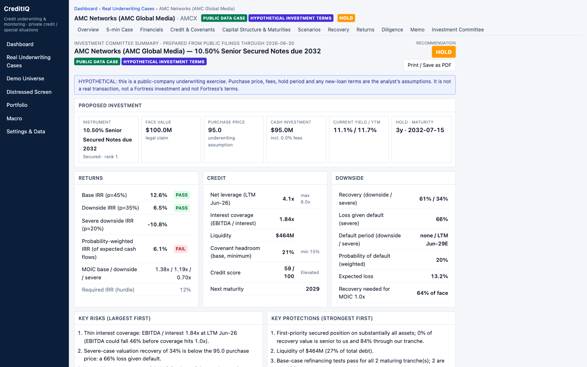
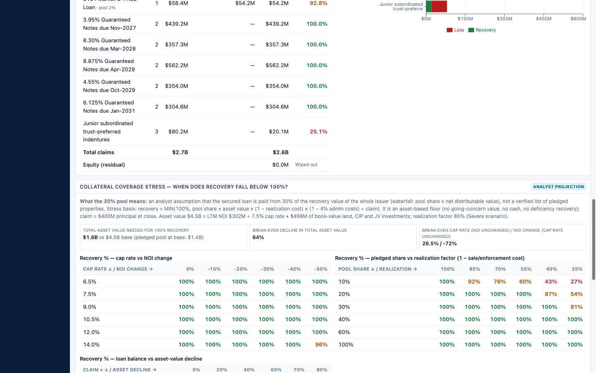

# CreditIQ

**An independently built credit-underwriting workbench.** Pick a real company, read its SEC-sourced numbers, challenge the assumptions, stress the cash flows, walk the recovery waterfall and reach an investment conclusion — in a web app and in a formula-driven Excel model that reconcile to each other.

> **Independent research project.** It is not a Fortress (or any firm's) product, was not used by anyone, and does not reproduce any firm's process. All investment terms in the real-company cases — purchase prices, the BDN loan, collateral pool, cap rate, scenarios, probabilities — are **hypothetical analyst assumptions**. Nothing here is a market quote, a real transaction or investment advice.

## What it models
Underwriting a position in a company's debt, in the order an analyst would: **assumptions → financial statements → cash flow → debt schedule → credit metrics → covenants → refinancing → default → recovery waterfall → returns → recommendation**, under Base / Downside / Severe scenarios. It answers: *what are we paid, what do we get back if it goes wrong, and is that enough?*

## Real-company cases (start here)
| Case | Hypothetical position | Result (audited model) | Documents |
|---|---|---|---|
| **AMC Networks (AMCX)** — corporate credit | $100M of the 10.50% senior secured notes due 2032 at an assumed price of 95 | Base IRR 12.6%, downside 6.5%, severe −10.8%; **probability-weighted IRR 6.1%**; downside recovery 60.6% → **HOLD** | [Investment case](docs/INVESTMENT_CASE_AMCX.md) · `/companies/amcx` · [workbook](models/CreditIQ_AMCX_Model.xlsx) |
| **Brandywine Realty Trust (BDN)** — real-estate credit | $100M of a hypothetical $400M first-lien term loan, S+525, 1% floor, price 98, assumed 30% collateral pool | Base IRR 9.6% vs 10% hurdle; probability-weighted 9.3%; 100% recovery that **depends on the assumed pool** (breaks at a ~64% asset-value decline, or immediately at a 10% pool) → **HOLD** | [Investment case](docs/INVESTMENT_CASE_BDN.md) · `/companies/bdn` · [workbook](models/CreditIQ_BDN_Model.xlsx) |
Also: sixteen fictional **DEMO** companies (always labelled DEMO DATA) that exercise the screen, portfolio and monitoring views; one of them, Brightwater Retail, has its own [workbook](models/CreditIQ_BRIGHTWATER_Model.xlsx).
**Investment-committee analysis:** `/companies/amcx/investment-committee`, `/companies/bdn/investment-committee`. A 2–3 minute walkthrough is in the [demo script](docs/DEMO_SCRIPT.md).

## Screenshots
| | |
|---|---|
|  |  |
|  |  |
|  |  |
|  |  |

## How to read the numbers (data classes shown on every page)
- **PUBLIC FILING** — as printed in SEC filings, with filing, accession, date, URL, section/page and retrieved date per datapoint (`data/real/*.datapoints.json`).
- **Derived historical** — computed from filings with the formula carried along (LTM = FY + H1 − H1; AOI/NOI rebuilt and tied to the company's reported figure).
- **ANALYST PROJECTION** — the model's scenario forecasts.
- **HYPOTHETICAL INVESTMENT TERMS / UNDERWRITING ASSUMPTION** — prices, loan terms, pools, cap rates, multiples, probabilities, hurdles.
- **DEMO DATA** — fictional companies; never presented as filed.

## What is distinctive
- **Return metrics are defined, not just shown:** annual-period IRR, contractual-timing IRR (semiannual/quarterly coupons), XIRR cross-check, MOIC, and a probability-weighted IRR computed as the IRR of the expected cash flows (not an average of IRRs). See [methodology §5](docs/INVESTMENT_METHODOLOGY.md).
- **Recovery with priority:** MAX(going concern, liquidation) + cash, administrative costs, collateral pools and deficiency claims, strict seniority; plus a collateral-coverage stress for secured loans.
- **Debt as it stands today:** AMCX is modelled after its 2026 exchange (2029 secured notes extinguished into 2032 notes) and the May-2026 revolver termination — principal, not carrying value.
- **Excel as a real deliverable:** blue inputs, black same-sheet formulas, green cross-sheet links; 63 Calc-Engine scenarios feed seven sensitivity tables without data tables.

## Verification (details: [MODEL_VALIDATION](docs/MODEL_VALIDATION.md), [RELEASE_READINESS](docs/RELEASE_READINESS.md))
103 unit tests · 110 workbook audit checks (formula rules, independent Python recomputation of debt roll-forward, leverage, coverage, recovery waterfall and bounds, IRR/XIRR, expected and contractual-timing IRR) · Excel ⇄ web reconciliation on 178 metrics per case (276 for BDN) · 89 change-impact tests (29 AMCX / 30 BDN / 30 Brightwater: edit an input, recalculate in LibreOffice, assert direction and size) with the committed workbooks proven unchanged · public datapoints re-verified against the filing text with a row/column check (AMCX 101, BDN 112, 0 failures) · 53 routes browser-checked. Known gaps are listed in RELEASE_READINESS §6.

## Run it
```bash
npm install
npm run dev                  # http://localhost:3000   (production: npm run build && npm start)
npm test && npm run typecheck && npm run lint
npm run data:verify          # datapoints vs cached filing text in data/sec/ (git-ignored; recreate with SEC_USER_AGENT="Name email" python3 scripts/fetch_filings.py)
npm run model:build          # export cases, build 3 workbooks (LibreOffice recalc), reconcile to the web engine
npm run model:audit          # 110 workbook audit checks
npm run model:harness:all    # change-impact tests, all workbooks in parallel (or :amcx / :bdn / :brightwater; `npm run model:harness` runs them in sequence)
python3 scripts/validation_report.py   # regenerate docs/MODEL_VALIDATION.md from the run artefacts
```
Excel tooling needs python3 + openpyxl + LibreOffice (`soffice`). `.env.example`: `SEC_USER_AGENT` is only needed for the optional live SEC lookup and refetching filings; no API keys are used. The app needs neither `data/sec/` nor `models/` at run time.

## Docs
[INVESTMENT_METHODOLOGY](docs/INVESTMENT_METHODOLOGY.md) · [ARCHITECTURE](docs/ARCHITECTURE.md) · [DATA_SOURCES](docs/DATA_SOURCES.md) · [MODEL_VALIDATION](docs/MODEL_VALIDATION.md) · [RELEASE_READINESS](docs/RELEASE_READINESS.md) · [DEMO_SCRIPT](docs/DEMO_SCRIPT.md)

## Technology
Next.js (App Router) + TypeScript + Tailwind + Recharts, Zod-validated inputs, Vitest; Excel generated with openpyxl and recalculated with LibreOffice.

## Limitations
Hypothetical prices/terms and scenario probabilities; the BDN pool share and cap rate are assumptions (no property values are disclosed); recovery takes the higher of going-concern and liquidation value on book-value collateral; annual operating forecast; disclosed covenants tested on proxy definitions; scores are ordinal, not calibrated probabilities; no live market prices; demo companies are fictional.
